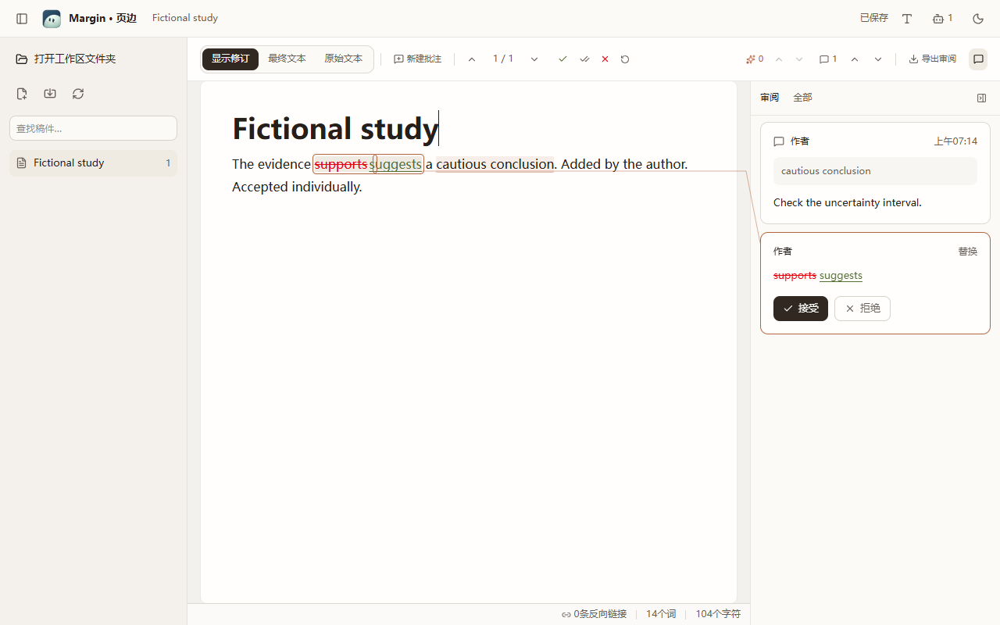
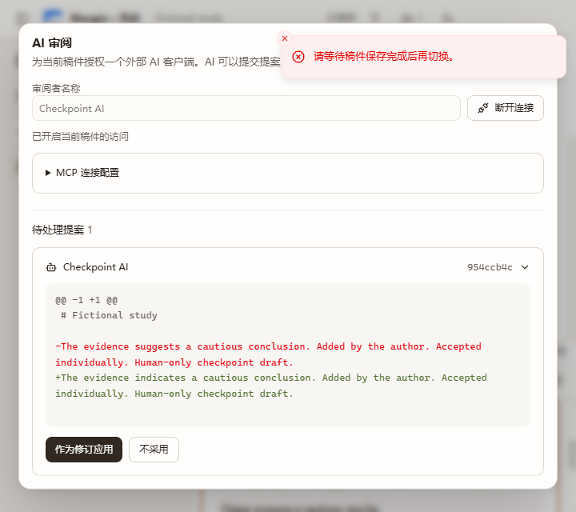

<p align="center">
  
</p>

<h1 align="center">Margin · 页边</h1>

<p align="center"><strong>把修改留在文中，把讨论留在页边。</strong></p>
<p align="center">一个本地优先的稿件审阅桌面应用。像 Word 一样追踪修订，与一个 AI 审阅者在同一篇稿件上协作，最终决定始终由你作出。</p>

<p align="center">
  <b>中文</b> · <a href="README.en.md">English</a> · <a href="docs/margin.md">项目说明</a> · <a href="docs/margin-single-ai.md">接入 AI</a> · <a href="LICENSE">MIT</a>
</p>

> **开发预览，尚无正式安装包。** 当前 checkpoint 是「单 AI + 本机作者」，不是多 AI 协作平台，也不是 Edda 的完整科研工作台。请先备份重要稿件。

<p align="center">
  
</p>

## 先审阅，再决定

- **正文就是审阅现场**：绿色插入、红色删除，支持显示修订、最终文本、原始文本三种视图；逐处或全部接受 / 拒绝，不用在聊天记录里找改动。
- **讨论贴着原文**：批注锚定选中文字，作者和 AI 在同一线程回复；页边卡片与正文联动，窄窗口下审阅栏移到底部。
- **AI 提建议，人做裁决**：外部 AI 先提交待处理提案。你预览后将它应用为行内修订，再决定接受或拒绝；AI 不能直接覆盖正文或替你确认修改。
- **保存有版本边界**：正文、基线、线程、裁决与事件存入每稿独立的 SQLite。旧版本操作明确冲突，重复请求不会重复写入，未保存草稿不会被新快照覆盖。
- **数据留在工作区**：选择普通文件夹即可开始。可导出正文、基线、完整审阅数据库与附件，也可从导出的数据库恢复为新稿件。

## 本地运行

需要 Node.js 24+、pnpm（版本见 `package.json`）、Rust stable，以及对应系统的 [Tauri 2 开发环境](https://v2.tauri.app/start/prerequisites/)。Windows 需要 C++ 构建工具和 WebView2。

```sh
git clone https://github.com/Becomingw/Margin-Next.git
cd Margin-Next
pnpm install --frozen-lockfile
pnpm tauri dev
```

首次启动会准备 PDFium 并编译原生 Host，可能需要下载依赖。PowerShell 禁止执行 `.ps1` 时，把 `pnpm` 换成 `pnpm.cmd`。

1. 打开一个工作区文件夹，新建稿件或导入 Markdown。
2. 编辑正文、添加批注，用接受 / 拒绝处理修订；正文自动保存。
3. 需要 AI 时，点击标题栏的 **AI 审阅**，授权当前稿件。
4. 审阅完成后导出，保留正文和可恢复的审阅记录。

`pnpm dev` 仅启动前端预览，浏览器不提供本地文稿读写能力。当前主要验证环境是 Windows / WebView2；尚未提供经过独立发布验证的跨平台安装包。

## 与一个 AI 一起审

Margin 提供审阅专用的 **Streamable HTTP MCP**，不内置模型聊天，也不代替你运行 AI 客户端。

1. 打开稿件 → **AI 审阅** → 选择署名 → **开启访问**。
2. 展开并复制 MCP 连接配置，加入你使用的、支持 HTTP MCP 与请求头配置的 AI 客户端。
3. 保持 Margin 运行，在客户端发出任务，例如：

   > 请读取当前稿件和批注，在同一线程回复我的问题。正文修改请提交提案，等我处理后，再读取裁决和回复继续讨论。

4. 回到 Margin，预览待处理提案，选择 **作为修订应用** 或 **不采用**。

<p align="center">
  
</p>

授权固定到一篇稿件和一个审阅身份。AI 能读已保存正文、批注、回复和裁决，看不到未保存草稿；它不能编辑作者创建的评论、应用提案、接受修订或解决线程。保存了新版本后，旧提案需重新提交，不会自动合并。

连接只监听本机随机端口，需要 Bearer 凭证。断开连接或切换稿件会撤销旧授权。**不要公开连接配置或令牌。** 这个边界只约束 Margin MCP，不限制外部 AI 客户端自身的文件或命令工具；你交给外部客户端的数据仍受其模型 / 服务商政策影响。

完整工具契约、安全边界与验证方式见 [单 AI checkpoint](docs/margin-single-ai.md)。

## 数据如何保存

```text
你的工作区/
└── .margin/documents/<稿件 ID>/
    ├── review.sqlite       # 正文版本、基线、提案、线程、裁决、事件
    ├── manuscript.pdf      # 可选参考 PDF
    └── assets/             # 可选附件
```

- 正文以数据库中的不可变版本为准，**不是一份可在外部同时编辑的 `manuscript.md`**。
- 应用导出包含一致的数据库快照、`manuscript.md`、`baseline.md`、可读审阅 JSON 和附件。导入导出的 `review.sqlite` 可恢复为新稿件。
- 运行中可能有 `review.sqlite-wal` / `review.sqlite-shm`；备份优先使用应用导出，不要只拷贝运行中的主数据库。
- 旧 Edda `reviews/` 数据只读迁入，原文件保留；迁入后不再双向同步。附件目前不做版本管理。

细节见 [事务文档后端](docs/backend/margin.md)。

## 当前边界

- **不是 LaTeX 原位编辑器**：TeX 导入和 Plate 序列化不保证源码逐字节不变。
- **PDF / 复杂稿件仍需验证**：保留参考 PDF 和上游解析适配，不宣称已验证离线 OCR、复杂版式或长稿件的全部流程。AI 工具以 Markdown 正文为准，不直接读取 PDF / 图片。
- **不含多 AI 与自动合并**：单一审阅角色，没有内置 AI 自动运行、三方合并、远程多用户协作或身份认证。
- **不是正式发行版**：完整历史浏览、跨稿件评论草稿保护、依赖裁剪、安装包与发布前权限 / CSP 审计仍在后续范围。

## 开发与验证

Tauri 2 · React 19 · TypeScript · Plate · Rust · SQLite。

```sh
pnpm typecheck
pnpm test
pnpm build
cargo test -p margin-core features::margin --lib
cargo test -p margin-desktop margin::ai::tests --lib
cargo clippy --workspace --all-targets -- -D warnings
```

真实 Windows 桌面回归使用 `pnpm test:margin-native`，需要可见的开发窗口和 CDP 调试端口，启动方式见 [运行与验证](docs/margin.md#运行与验证)。回归覆盖真实 HTTP MCP / SQLite 的读稿、署名回复、幂等重试、脏草稿保护、过期提案、用户裁决与授权撤销；不代表验证过实际大模型的生成质量。

主要入口：`src/margin/`（独立前端）、`src-tauri/src/margin/`（Host / MCP）、`crates/margin-core/src/features/margin/`（事务核心）。默认 Host 不编译旧工作台；`legacy-workbench` 只供源码兼容检查，禁止用于 release 构建。[开发索引](docs/development/index.md) 中的上游规划不自动纳入 Margin。

## 来源与许可证

Margin 的审阅基础提取自 [Edda](https://github.com/Becomingw/Edda) v0.19.0，保留并改造其编辑器、行内修订和批注能力。图标延续其哑光吉祥物风格，使用 Google / Material 产品风格启发的蓝、红、黄、绿配色，但不是 Google 产品或官方标识。公开仓库从独立根提交开始，不携带 Edda 的 Git 提交历史；**这不表示所有源码都是新写的**，继承的未用模块与旧文档仍在逐步裁剪。

本项目不同于旧 Margin 实现，不复用旧项目的 DOM / Node 后端。MIT 许可证与原作者署名保留，详见 [LICENSE](LICENSE) 和 [NOTICE.md](NOTICE.md)。
